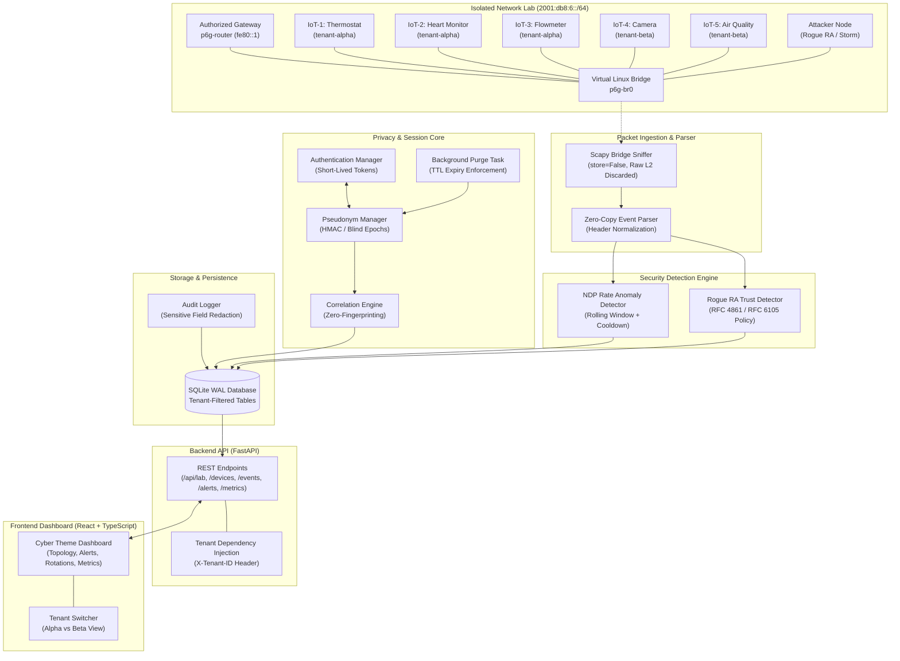
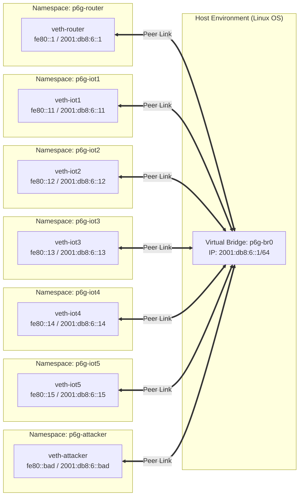
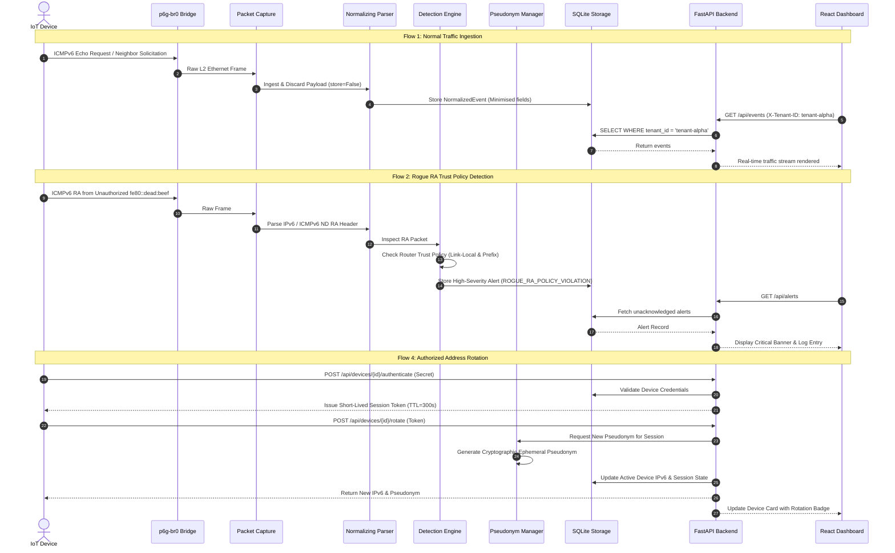
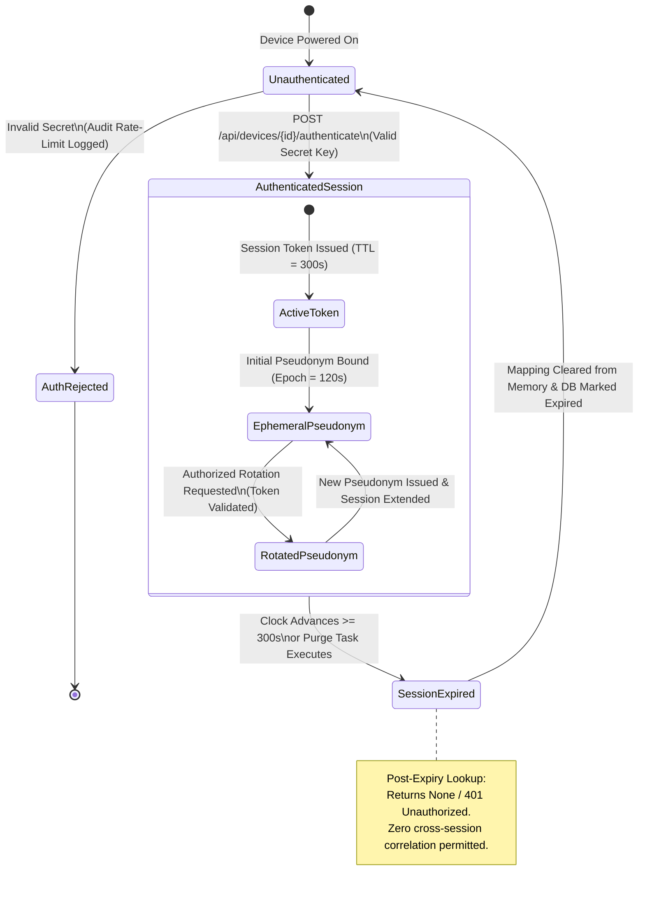
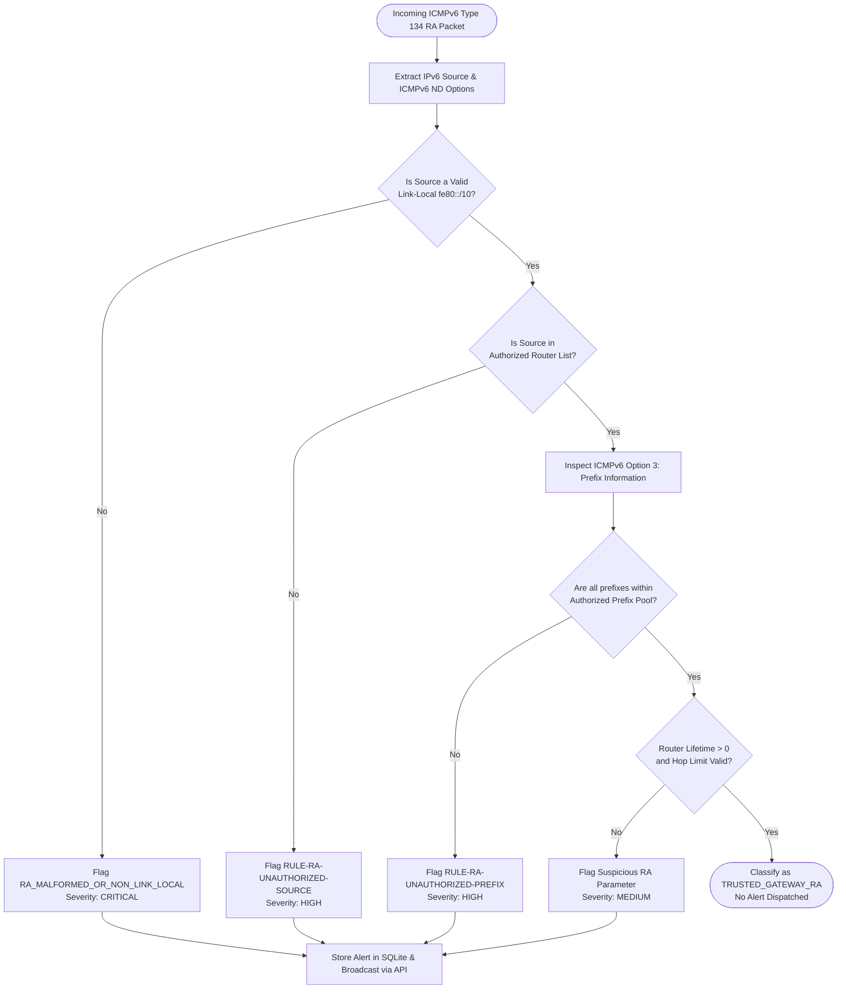
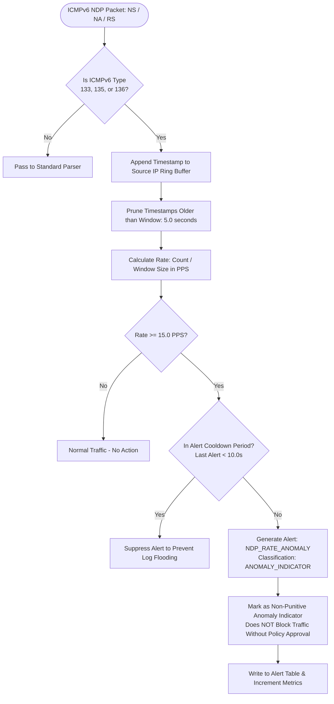
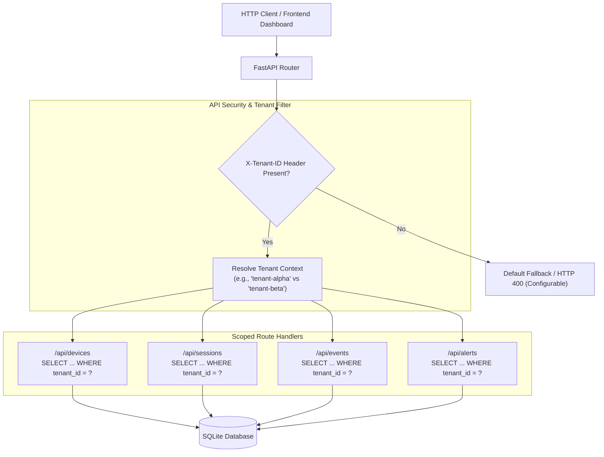

# PRIV6GUARD Architecture & System Design
**Privacy-Aware IPv6 IoT Security Monitoring Across Address Rotation**

> **AIORI Hackathon 3 | Problem Statement: PS-007 | Team Code: A3-PS007-TC254**  
> **Official Demo & Presentation**: [Watch YouTube Video](https://youtu.be/BkqlxewUyNs) | [Solution Slide Deck (PDF)](../A3-PS007-TC254-PPT.pdf)

---

## 1. High-Level Architecture Overview

Priv6Guard is structured into four decoupled, fail-safe layers:
1. **Isolated Lab & Traffic Layer**: Virtual Linux bridge (`p6g-br0`) and dedicated network namespaces providing an isolated `2001:db8:6::/64` IPv6 subnet with zero packet leakage to host interfaces.
2. **Packet Processing & Detection Layer**: Scapy sniffer (`store=False`) streaming raw ICMPv6 packets to the zero-copy parser, which extracts normalized events and routes them to the Router Advertisement (RFC 4861/6105) and rolling-window NDP anomaly detectors.
3. **Session & Cryptographic Pseudonym Layer**: Short-lived session token issuance ($TTL=300\text{s}$), blind epoch pseudonyms ($120\text{s}$ epoch), and strict authorization-bound correlation without hardware/behavioral fingerprinting.
4. **Data & Presentation Layer**: SQLite WAL storage with database-level multi-tenancy (`tenant_id`), FastAPI asynchronous REST API, and a React + TypeScript + Vite cyber dashboard with multi-tenant switching.



---

## 2. Network Topology Diagram

The isolated network environment guarantees that all emulated devices, gateways, and attack tools communicate exclusively over a private bridge interface without touching host physical adapters (`eth0`, `wlan0`).



---

## 3. End-to-End Data Flow

The following sequence details how normal traffic, detection alerts, address rotations, and privacy enforcements flow through the system:



---

## 4. Session & Pseudonym Lifecycle



---

## 5. Rogue Router Advertisement (RA) Detection Flow

Priv6Guard enforces an explicit trust policy according to RFC 4861 and RFC 6105. Crucially, routers are **never** flagged as rogue merely due to packet transmission frequency; classification is based strictly on cryptographic identity and authorized topological prefixes.



---

## 6. Neighbor Discovery Protocol (NDP) Anomaly Detection Flow

High-rate Neighbor Solicitations (NS), Neighbor Advertisements (NA), and Router Solicitations (RS) can indicate network scanning, address exhaustion, or denial-of-service. Priv6Guard implements a rolling time-window accumulator with cooldown suppression to identify bursts without penalizing legitimate network reconvergences.



---

## 7. REST API Architecture & Tenant Boundaries

The backend enforces multi-tenancy at the controller and query level. The `get_current_tenant` dependency extracts the `X-Tenant-ID` header, rejecting unauthorized requests with HTTP 400/403.



---

## 8. Threat Model (STRIDE)

| Threat Category | Specific Threat | System Mitigation | Residual Risk |
| :--- | :--- | :--- | :--- |
| **Spoofing** | Attacker spoofs an authorized gateway IPv6 link-local address (`fe80::1`) to inject illegitimate routes. | `RouterAdvertisementDetector` verifies source L2 MAC against authorized lab topology and flags link-local anomalies. | If attacker achieves root access to the gateway namespace, MAC spoofing is possible at L2. |
| **Tampering** | Attacker tampers with ICMPv6 prefix information options to redirect client subnet routes. | Strict prefix validation (`RAPolicyConfig.authorized_prefixes = ['2001:db8:6::/64']`) flags unauthorized prefixes immediately. | Subnet-internal routing redirects within the authorized `/64` prefix require upper-layer inspection. |
| **Repudiation** | Attacker denies generating an NDP storm or scanning IoT interfaces. | Structured, immutable audit trail records IP, packet timestamp, and rate metrics with HMAC checksums. | Audit logs stored on local SQLite can be tampered with if host OS root is compromised. |
| **Information Disclosure** | Passive adversary sniffs bridge packets to track IoT devices across temporary IPv6 address changes. | Zero-fingerprint policy: no hardware profiling, MAC retention, or TLS fingerprints. Temporary addresses rotate under RFC 8981. | External traffic volume analysis and fixed communication timing could allow statistical correlation. |
| **Denial of Service** | Rogue node floods 10,000 Neighbor Solicitations per second to exhaust router neighbor tables. | `NDPRateAnomalyDetector` identifies bursts within 200ms and triggers rate-limiting alerts; ring buffers prevent unbounded memory growth. | Prototype flags the attack but does not automatically drop L2 bridge packets without firewall integration. |
| **Elevation of Privilege** | Tenant B attempts to read security alerts and device pseudonyms belonging to Tenant A. | Multi-tenant SQL parameterization (`WHERE tenant_id = ?`) enforced in API dependency injection. | Cross-tenant memory leaks possible if underlying Python runtime or SQLite engine has unpatched vulnerabilities. |

---

## 9. Privacy Limitations & Tracking Analysis

1. **Passive Traffic Analysis**: While PRIV6GUARD prevents link-layer and address-based tracking across rotations, a network eavesdropper monitoring packet timings and flow sizes (e.g., periodic MQTT pulses every 60 seconds) can still perform statistical traffic correlation.
2. **Ephemeral Identity Scope**: Pseudonyms are unique to an active, authorized session ($TTL=300\text{s}$). Once expired, continuity is severed; however, during the active epoch, all events from that device share the same pseudonym.
3. **Upper-Layer Fingerprinting**: Application-layer protocols (e.g., HTTP User-Agent, TLS ClientHello cipher suite order, CoAP options) are intentionally not scrubbed by PRIV6GUARD, as deep packet inspection violates data minimization principles.
4. **Local Subnet Confinement**: PRIV6GUARD's privacy guarantees apply to the local L2/L3 IPv6 segment. When packets traverse wide-area networks (WAN), ISP-level routing prefixes (`/48` or `/56`) remain visible to upstream providers.

---

## 10. Core Algorithms & Mentor Demonstration Pseudocode (Deliverable 3)

The following formal pseudocode snippets specify the three mathematical algorithms driving Priv6Guard, fulfilling **Deliverable 3** (*"Prototype Demonstration with a Pseudocode Snippet to the mentor"*).

### Algorithm 1: Privacy-Preserving Address Rotation & Ephemeral Pseudonym Correlation
Governs how devices rotate IPv6 addresses without permitting persistent hardware tracking or cross-session graph linkage.

```python
"""
ALGORITHM 1: Privacy-Preserving Address Rotation & Ephemeral Pseudonym Binding
Implements RFC 8981 address transition under short-lived cryptographic authorization.
"""

# Global State:
ActiveSessions = {}     # token -> {device_id, tenant_id, expires_at}
ActiveMappings = {}     # pseudonym -> {ipv6, session_id, tenant_id, epoch_expires}

function AuthenticateDeviceSession(device_id, preshared_secret, tenant_id):
    """Issues a short-lived session token (TTL = 300s). Rejects invalid credentials."""
    if not VerifySecret(device_id, preshared_secret) or TenantOf(device_id) != tenant_id:
        AuditLog("AUTH_REJECTED", device_id, tenant_id)
        return (401_UNAUTHORIZED, null)
    
    session_token = GenerateCryptographicRandomToken(entropy_bits=256)
    ActiveSessions[session_token] = {
        "device_id": device_id,
        "tenant_id": tenant_id,
        "expires_at": CurrentTimeUTC() + 300  # seconds
    }
    AuditLog("AUTH_SUCCESS", device_id, tenant_id)
    return (200_OK, session_token)

function RotateAddressUnderSession(session_token, old_ipv6, tenant_id):
    """
    Authorizes RFC 8981 address rotation.
    Decouples persistent hardware ID by issuing a fresh blind HMAC pseudonym.
    """
    session = ActiveSessions.get(session_token)
    if session is null or session.expires_at <= CurrentTimeUTC() or session.tenant_id != tenant_id:
        AuditLog("ROTATION_DENIED", old_ipv6, tenant_id, reason="EXPIRED_OR_INVALID_SESSION")
        return (403_FORBIDDEN, null, "Correlation denied: invalid or expired session.")

    # RFC 8981: Generate randomized temporary 64-bit interface identifier (IID)
    new_iid = SecureRandomBytes(8)
    new_ipv6 = ConstructIPv6(prefix="2001:db8:6::/64", iid=new_iid)

    # Cryptographic blind pseudonym: HMAC-SHA256 with ephemeral epoch secret
    pseudonym = "p6g-ps-" + Base64UrlSafe(HMAC_SHA256(key=EphemeralSecret, data=new_iid))

    # Bind pseudonym strictly to this session epoch (TTL = 120s)
    ActiveMappings[pseudonym] = {
        "ipv6": new_ipv6,
        "session_id": session_token,
        "tenant_id": tenant_id,
        "epoch_expires": CurrentTimeUTC() + 120  # seconds
    }

    # Automatically purge expired records to prevent memory retention
    PurgeExpiredMappings()

    AuditLog("ROTATION_AUTHORIZED", tenant_id, pseudonym=pseudonym)
    return (200_OK, new_ipv6, pseudonym)

function PurgeExpiredMappings():
    """Permanent memory and DB purge: expired records cannot be correlated."""
    now = CurrentTimeUTC()
    for pseudonym, rec in list(ActiveMappings.items()):
        if rec.epoch_expires <= now:
            del ActiveMappings[pseudonym]
            AuditLog("MAPPING_PURGED", pseudonym, reason="EPOCH_EXPIRED")
```

---

### Algorithm 2: Frequency-Invariant Rogue Router Advertisement Policy Enforcement
Validates gateway legitimacy using RFC 4861 / RFC 6105 policy constraints. Crucially, legitimate routers retransmitting RAs frequently are **never** flagged as rogue (Frequency Invariance Invariant).

```python
"""
ALGORITHM 2: Frequency-Invariant Rogue RA Trust Policy Detection (RFC 4861/6105)
Ensures gateways are validated by topological authority, not transmission rate.
"""

# Configured Local Policy:
AuthorizedGateways = {"fe80::1"}
AuthorizedPrefixes = {"2001:db8:6::/64"}
MaxAllowedLifetime = 1800  # seconds

function InspectRouterAdvertisement(packet, interface="p6g-br0"):
    if not packet.has_layer(ICMPv6_ROUTER_ADVERTISEMENT):
        return BenignNoAction("NON_RA_MESSAGE")

    src_ll = packet.ipv6.source_address

    # Invariant 1: Source MUST be an authorized link-local router address
    if not IsLinkLocal(src_ll) or src_ll not in AuthorizedGateways:
        return TriggerAlert(
            rule_id="RULE-RA-UNAUTHORIZED-SOURCE",
            severity="CRITICAL",
            source=src_ll,
            reason="Unapproved gateway link-local identity injecting default routes."
        )

    # Invariant 2: Prefix Information Options (PIO) must match approved local subnets
    for pio in packet.icmpv6_options.prefix_info_options:
        prefix_str = pio.prefix + "/" + str(pio.prefix_length)
        if prefix_str not in AuthorizedPrefixes:
            return TriggerAlert(
                rule_id="RULE-RA-UNAUTHORIZED-PREFIX",
                severity="HIGH",
                source=src_ll,
                reason="Foreign/unauthorized prefix announcement detected."
            )

    # Invariant 3: Lifetime bounds checking
    if packet.router_lifetime > MaxAllowedLifetime:
        return TriggerAlert(
            rule_id="RULE-RA-ABNORMAL-LIFETIME",
            severity="MEDIUM",
            source=src_ll,
            reason="Router lifetime exceeds maximum operational threshold."
        )

    # FREQUENCY INVARIANCE: Even at 100 RAs/sec, an authorized gateway is TRUSTED.
    RecordBenignTelemetry(source=src_ll, interface=interface)
    return BenignNoAction("TRUSTED_GATEWAY_RA")
```

---

### Algorithm 3: Rolling-Window NDP Rate Anomaly Detector with Cooldown Suppression
Measures Neighbor Solicitation (NS) and Neighbor Advertisement (NA) message rates. Classifies bursts strictly as non-punitive anomaly indicators.

```python
"""
ALGORITHM 3: Rolling-Window NDP Rate Anomaly Detector
Detects scanning/exhaustion floods while tolerating legitimate network re-convergence.
"""

# Configuration:
WindowSizeSeconds = 5.0
ThresholdPPS      = 15.0  # Packets per second
CooldownSeconds   = 10.0

# State:
TimestampQueues = {}    # (source_ip, msg_type) -> Deque of float timestamps
LastAlertTime   = {}    # (source_ip, msg_type) -> timestamp

function InspectNDPPacket(packet, interface="p6g-br0"):
    msg_type = packet.icmpv6.type   # 135 = NS, 136 = NA, 133 = RS
    if msg_type not in {133, 135, 136}:
        return PassToEventPipeline(packet)

    src_ip = packet.ipv6.source_address
    key = (src_ip, msg_type)
    now = CurrentTimestamp()

    if key not in TimestampQueues:
        TimestampQueues[key] = Deque()

    queue = TimestampQueues[key]
    queue.push_back(now)

    # 1. Slide window: prune timestamps older than WindowSizeSeconds
    cutoff = now - WindowSizeSeconds
    while queue is not empty and queue.front() < cutoff:
        queue.pop_front()

    # 2. Compute current sliding-window packet rate
    observed_count = queue.size()
    current_rate_pps = observed_count / WindowSizeSeconds

    # 3. Check threshold violation
    if current_rate_pps >= ThresholdPPS:
        # Cooldown check to prevent log flooding
        last_alert = LastAlertTime.get(key, 0)
        if (now - last_alert) >= CooldownSeconds:
            LastAlertTime[key] = now
            return TriggerAlert(
                rule_id="RULE-NDP-RATE-ANOMALY",
                classification="ANOMALY_INDICATOR_NOT_DEFINITIVE_PROOF",
                severity="MEDIUM",
                source=src_ip,
                current_rate=current_rate_pps,
                threshold=ThresholdPPS
            )
        else:
            return SuppressAlert("COOLDOWN_ACTIVE")

    return NormalNDPTraffic(current_rate_pps)
```

